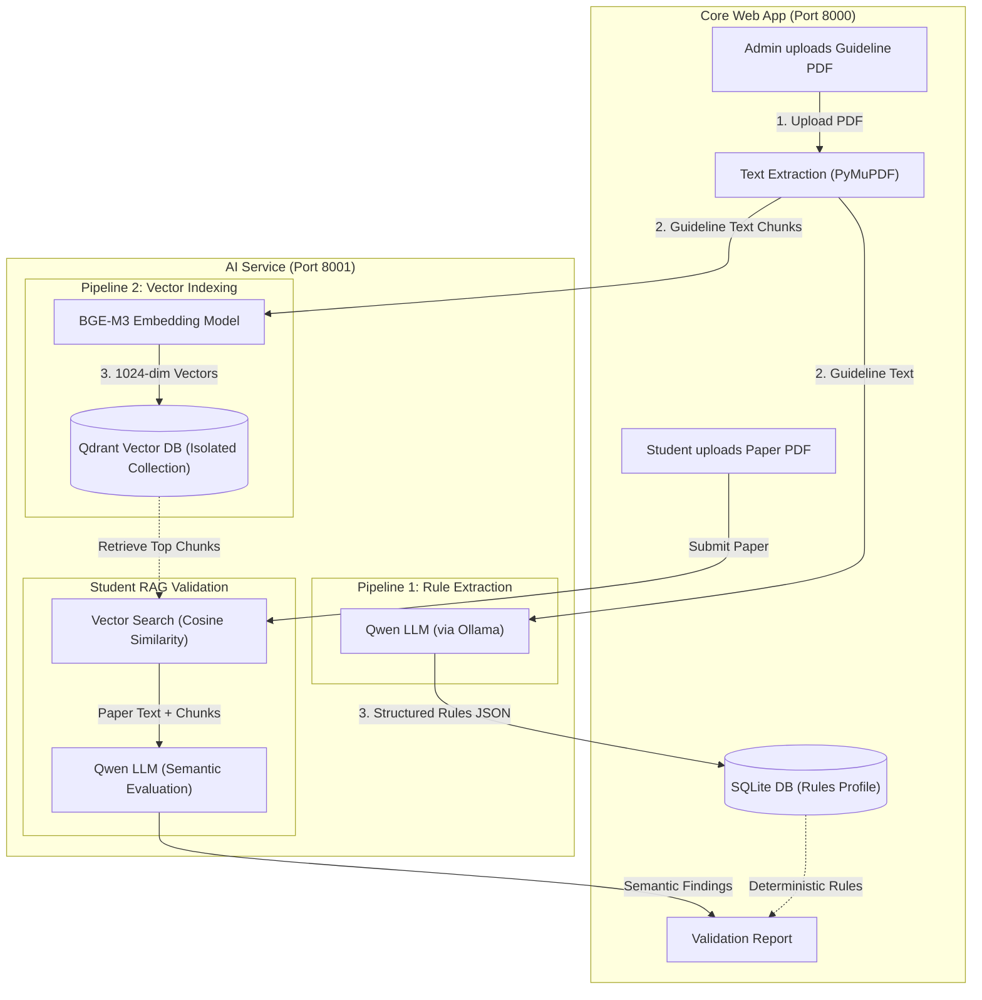

# UniSubmit AI — How Qdrant, BGE-M3 & RAG Work Together

## Architecture Overview



## The Three Components

| Component | Role | Technology |
|-----------|------|------------|
| **Embedding Model** | Converts text → 1024-dimension dense vectors | `BAAI/bge-m3` (FlagEmbedding) |
| **Vector Database** | Stores and searches vectors by cosine similarity | Qdrant (port 6333) |
| **LLM** | Extracts rules from guidelines, evaluates student papers | Qwen 3.5 via Ollama |

---

## Flow 1: Admin Uploads a Guideline PDF (Per-Program Indexing)

> [!IMPORTANT]
> Each program/department gets its **own isolated Qdrant collection**. Guidelines are never mixed across programmes.

### What happens step by step:

When an admin clicks **"Parse & Index Guideline"** on the template version page, the core app calls [`index_guideline()`](file:///opt/homebrew/var/www/pvs/UniSubmit_AI_v9_10_2_Guideline_Parser_Fix/unisubmit_ai/app/main.py#L547-L598):

### Step 1 — Parse the Guideline (Qwen LLM)

The core app sends the PDF to [`POST /guideline/profile`](file:///opt/homebrew/var/www/pvs/UniSubmit_AI_v9_10_2_Guideline_Parser_Fix/unisubmit_ai/ai_service/main.py#L1206-L1337):

1. **Extract text** from each PDF page using PyMuPDF
2. **Send to Qwen** with a structured prompt asking it to extract:
   - **Deterministic rules** (measurable: font size, margins, page limits, etc.)
   - **Semantic requirements** (qualitative: "abstract must summarise the research objectives")
3. **Return** a structured JSON profile of all extracted rules

### Step 2 — Index into Qdrant (BGE-M3 + Qdrant)

The core app then sends the same PDF to [`POST /rag/index-template`](file:///opt/homebrew/var/www/pvs/UniSubmit_AI_v9_10_2_Guideline_Parser_Fix/unisubmit_ai/ai_service/main.py#L467-L579):

1. **Extract text** from each page → split into overlapping chunks (1200 chars, 200 char overlap)
2. **Embed each chunk** using BGE-M3 → produces a 1024-dim dense vector per chunk
3. **Create a unique Qdrant collection** named by slugifying: `{department}_{program}_{submission_type}_{template_version}`
4. **Upsert** all vectors + metadata (text, page number, department, programme) into Qdrant

### Example: Two Different Programmes

```
Programme: "Computer Science" (Department: "Engineering")
  → Guideline: CS_thesis_guideline.pdf
  → Qdrant Collection: engineering_computer_science_thesis_v2024

Programme: "Business Administration" (Department: "Management")  
  → Guideline: BBA_project_guideline.pdf
  → Qdrant Collection: management_business_administration_project_v2024
```

Each collection is **completely isolated** — the CS guideline vectors never mix with the BBA vectors.

The collection naming logic is in [`make_collection_name()`](file:///opt/homebrew/var/www/pvs/UniSubmit_AI_v9_10_2_Guideline_Parser_Fix/unisubmit_ai/ai_service/main.py#L127-L138):

```python
def make_collection_name(department, program, submission_type, template_version):
    return "_".join([
        slugify(department),     # e.g. "engineering"
        slugify(program),        # e.g. "computer_science"
        slugify(submission_type),# e.g. "thesis"
        slugify(template_version)# e.g. "v2024"
    ])
```

---

## Flow 2: Student Uploads Their Paper

When a student submits a PDF, the system creates a queued validation job. The background worker [`process_job()`](file:///opt/homebrew/var/www/pvs/UniSubmit_AI_v9_10_2_Guideline_Parser_Fix/unisubmit_ai/app/main.py#L744-L779) runs these steps:

### Step 1 — Deterministic Checks (No AI needed)

```python
info = inspect_pdf(sv.pdf_path)           # Extract fonts, margins, page count, etc.
results, det_status = run_rules(tv.rules, info)  # Check measurable rules
format_results = validate_all_profile_rules(fmt_profile, info)  # Profile-based checks
```

These check things like:
- ✅ Page size = A4?
- ✅ Font = Times New Roman 12pt?
- ✅ Margins = 25.4mm?
- ✅ Line spacing = 1.5?
- ✅ Required sections present?

### Step 2 — RAG Semantic Validation (AI + Qdrant + BGE-M3)

If the programme has an AI profile and the guideline is indexed:

```python
if sub.ai_profile and tv.rag_status == 'Indexed':
    payload = {
        'department': sub.program.unit_name,
        'program': sub.program.name,
        'student_text': info['text'][:30000],  # Student's paper text
        'explicit_requirements': [...],         # Parsed semantic rules
        ...
    }
    ai = await rag_validate(sub.ai_profile.service_url, payload)
```

This calls [`POST /rag/validate`](file:///opt/homebrew/var/www/pvs/UniSubmit_AI_v9_10_2_Guideline_Parser_Fix/unisubmit_ai/ai_service/main.py#L745-L841) on the AI service, which:

1. **Builds the collection name** from department + programme + submission type + version
2. **Retrieves relevant guideline chunks** from Qdrant:
   - First, a general query retrieval (top 6 hits)
   - Then, **per-requirement targeted retrieval** — each semantic requirement is used as a separate search query (top 3 hits each)
   - Deduplicates and keeps the top 40 hits by score

```python
hits = retrieve_chunks(collection_name, request.query, request.limit)
for req in explicit[:40]:
    for h in retrieve_chunks(collection_name, req['requirement'], 3):
        # add unique hits
```

3. **Embeds the query** using BGE-M3 to get a 1024-dim vector
4. **Searches Qdrant** with cosine similarity to find the most relevant guideline passages
5. **Builds a grounded prompt** for Qwen containing:
   - The retrieved guideline context (with page numbers and scores)
   - The parsed semantic requirements with targeted student section text
   - The student's full paper text as fallback
6. **Qwen evaluates** each semantic requirement against the student's paper:
   - `PASS` — requirement satisfied
   - `FAIL` — unmet mandatory requirement
   - `WARNING` — unmet non-mandatory requirement
   - `NOT VERIFIED` — insufficient evidence

### Step 3 — Report Generation

All results (deterministic + semantic) are combined into:
- A JSON validation result stored in the database
- A PDF validation report
- If PASSED → email sent to the supervisor

---

## RAG Retrieval: Concrete Example

Imagine a CS thesis guideline says on **page 5**: *"The abstract must not exceed 350 words and should clearly state the research objectives, methodology and key findings."*

### During Indexing:
```
Text chunk: "The abstract must not exceed 350 words and should clearly 
state the research objectives, methodology and key findings."
  → BGE-M3 embeds → [0.0234, -0.0891, 0.1456, ...] (1024 floats)
  → Stored in Qdrant collection "engineering_computer_science_thesis_v2024"
     with payload: {page: 5, text: "...", department: "Engineering", ...}
```

### During Student Validation:
```
Semantic requirement: "Abstract must state research objectives, methodology, and findings"
  → BGE-M3 embeds → [0.0198, -0.0903, 0.1502, ...] (similar vector)
  → Qdrant cosine similarity search → finds the page 5 chunk (score: 0.92)
  → Retrieved text sent to Qwen as "APPROVED GUIDELINE CONTEXT"
  → Qwen reads student's abstract + guideline context
  → Result: PASS (detected evidence: "The abstract mentions objectives 
     in paragraph 1, methodology in paragraph 2, and findings in paragraph 3")
```

---

## Summary Table

| Event | BGE-M3 | Qdrant | Qwen |
|-------|--------|--------|------|
| **Guideline uploaded** | Embeds guideline chunks → vectors | Stores vectors in programme-specific collection | Parses guideline → extracts rules |
| **Student paper uploaded** | Embeds search queries → vectors | Retrieves top matching guideline chunks | Evaluates student text against retrieved guideline context |

> [!NOTE]
> The key insight is **isolation by collection name**: each combination of department + programme + submission type + template version gets its own Qdrant collection. When a student from CS submits, only CS guideline chunks are retrieved — never BBA chunks. This makes the system multi-tenant safe.
