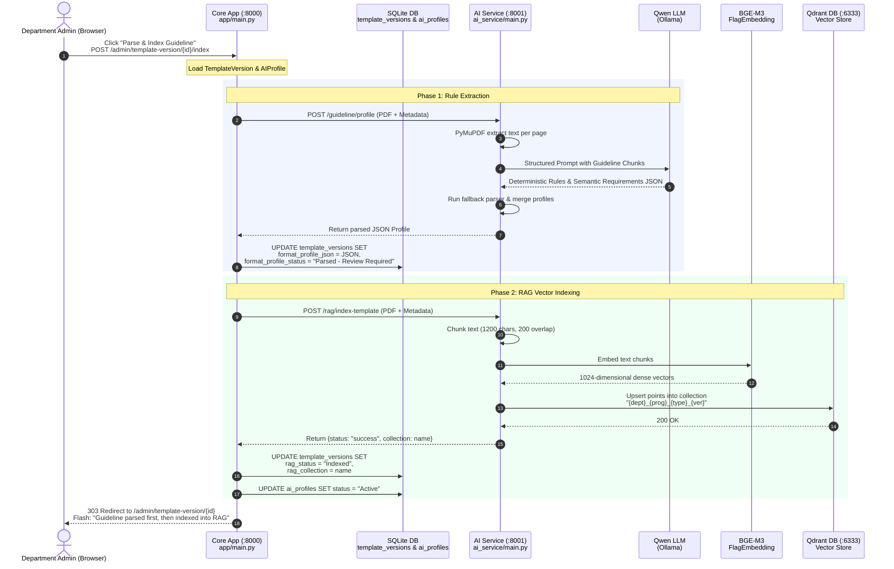

# UniSubmit AI — Guideline Parse & Index Pipeline

This document explains the end-to-end execution flow triggered when an administrator clicks **"Parse & Index Guideline"** on a guideline template version in the UniSubmit AI platform.

---

## Pipeline Sequence Diagram

### Rendered Visual Diagram
*(Renders automatically in any Markdown viewer without requiring extensions)*

![Parse and Index Pipeline](https://mermaid.ink/img/eyJjb2RlIjoic2VxdWVuY2VEaWFncmFtXG4gICAgYXV0b251bWJlclxuICAgIGFjdG9yIEFkbWluIGFzIERlcGFydG1lbnQgQWRtaW4gKEJyb3dzZXIpXG4gICAgcGFydGljaXBhbnQgQ29yZSBhcyBDb3JlIEFwcCAoOjgwMDApPGJyLz5hcHAvbWFpbi5weVxuICAgIHBhcnRpY2lwYW50IERCIGFzIFNRTGl0ZSBEQjxici8+dGVtcGxhdGVfdmVyc2lvbnMgJiBhaV9wcm9maWxlc1xuICAgIHBhcnRpY2lwYW50IEFJIGFzIEFJIFNlcnZpY2UgKDo4MDAxKTxici8+YWlfc2VydmljZS9tYWluLnB5XG4gICAgcGFydGljaXBhbnQgUXdlbiBhcyBRd2VuIExMTTxici8+KE9sbGFtYSlcbiAgICBwYXJ0aWNpcGFudCBCR0UgYXMgQkdFLU0zPGJyLz5GbGFnRW1iZWRkaW5nXG4gICAgcGFydGljaXBhbnQgUWRyYW50IGFzIFFkcmFudCBEQiAoOjYzMzMpPGJyLz5WZWN0b3IgU3RvcmVcblxuICAgIEFkbWluLT4+Q29yZTogQ2xpY2sgXCJQYXJzZSAmIEluZGV4IEd1aWRlbGluZVwiPGJyLz5QT1NUIC9hZG1pbi90ZW1wbGF0ZS12ZXJzaW9uL3tpZH0vaW5kZXhcbiAgICBOb3RlIG92ZXIgQ29yZTogTG9hZCBUZW1wbGF0ZVZlcnNpb24gJiBBSVByb2ZpbGVcblxuICAgIHJlY3QgcmdiKDI0MCwgMjQ1LCAyNTUpXG4gICAgTm90ZSBvdmVyIENvcmUsUXdlbjogUGhhc2UgMTogUnVsZSBFeHRyYWN0aW9uXG4gICAgQ29yZS0+PkFJOiBQT1NUIC9ndWlkZWxpbmUvcHJvZmlsZSAoUERGICsgTWV0YWRhdGEpXG4gICAgQUktPj5BSTogUHlNdVBERiBleHRyYWN0IHRleHQgcGVyIHBhZ2VcbiAgICBBSS0+PlF3ZW46IFN0cnVjdHVyZWQgUHJvbXB0IHdpdGggR3VpZGVsaW5lIENodW5rc1xuICAgIFF3ZW4tLT4+QUk6IERldGVybWluaXN0aWMgUnVsZXMgJiBTZW1hbnRpYyBSZXF1aXJlbWVudHMgSlNPTlxuICAgIEFJLT4+QUk6IFJ1biBmYWxsYmFjayBwYXJzZXIgJiBtZXJnZSBwcm9maWxlc1xuICAgIEFJLS0+PkNvcmU6IFJldHVybiBwYXJzZWQgSlNPTiBQcm9maWxlXG4gICAgQ29yZS0+PkRCOiBVUERBVEUgdGVtcGxhdGVfdmVyc2lvbnMgU0VUPGJyLz5mb3JtYXRfcHJvZmlsZV9qc29uID0gSlNPTiw8YnIvPmZvcm1hdF9wcm9maWxlX3N0YXR1cyA9IFwiUGFyc2VkIC0gUmV2aWV3IFJlcXVpcmVkXCJcbiAgICBlbmRcblxuICAgIHJlY3QgcmdiKDI0MCwgMjU1LCAyNDUpXG4gICAgTm90ZSBvdmVyIENvcmUsUWRyYW50OiBQaGFzZSAyOiBSQUcgVmVjdG9yIEluZGV4aW5nXG4gICAgQ29yZS0+PkFJOiBQT1NUIC9yYWcvaW5kZXgtdGVtcGxhdGUgKFBERiArIE1ldGFkYXRhKVxuICAgIEFJLT4+QUk6IENodW5rIHRleHQgKDEyMDAgY2hhcnMsIDIwMCBvdmVybGFwKVxuICAgIEFJLT4+QkdFOiBFbWJlZCB0ZXh0IGNodW5rc1xuICAgIEJHRS0tPj5BSTogMTAyNC1kaW1lbnNpb25hbCBkZW5zZSB2ZWN0b3JzXG4gICAgQUktPj5RZHJhbnQ6IFVwc2VydCBwb2ludHMgaW50byBjb2xsZWN0aW9uPGJyLz5cIntkZXB0fV97cHJvZ31fe3R5cGV9X3t2ZXJ9XCJcbiAgICBRZHJhbnQtLT4+QUk6IDIwMCBPS1xuICAgIEFJLS0+PkNvcmU6IFJldHVybiB7c3RhdHVzOiBcInN1Y2Nlc3NcIiwgY29sbGVjdGlvbjogbmFtZX1cbiAgICBDb3JlLT4+REI6IFVQREFURSB0ZW1wbGF0ZV92ZXJzaW9ucyBTRVQ8YnIvPnJhZ19zdGF0dXMgPSBcIkluZGV4ZWRcIiw8YnIvPnJhZ19jb2xsZWN0aW9uID0gbmFtZVxuICAgIENvcmUtPj5EQjogVVBEQVRFIGFpX3Byb2ZpbGVzIFNFVCBzdGF0dXMgPSBcIkFjdGl2ZVwiXG4gICAgZW5kXG5cbiAgICBDb3JlLS0+PkFkbWluOiAzMDMgUmVkaXJlY3QgdG8gL2FkbWluL3RlbXBsYXRlLXZlcnNpb24ve2lkfTxici8+Rmxhc2g6IFwiR3VpZGVsaW5lIHBhcnNlZCBmaXJzdCwgdGhlbiBpbmRleGVkIGludG8gUkFHXCIiLCJtZXJtYWlkIjp7InRoZW1lIjoiZGVmYXVsdCJ9fQ==)

### Mermaid Source


---

## Detailed Step-by-Step Code Execution

### 1. Trigger in Admin Web UI
* **UI File:** [`app/templates/template_version.html:21`](file:///opt/homebrew/var/www/pvs/UniSubmit_AI_v9_10_2_Guideline_Parser_Fix/unisubmit_ai/app/templates/template_version.html#L21)
* Clicking the **"Parse & Index Guideline"** button issues:
  ```http
  POST /admin/template-version/{version_id}/index
  ```

### 2. Core App Orchestration (`index_guideline`)
* **File:** [`app/main.py:1292-1415`](file:///opt/homebrew/var/www/pvs/UniSubmit_AI_v9_10_2_Guideline_Parser_Fix/unisubmit_ai/app/main.py#L1292-L1415)
* Verifies admin authentication and permissions for the target program.
* Ensures an `AIProfile` record exists in the SQLite database for `(program_id, submission_type)`.
* Prepares guideline metadata (`department`, `program`, `submission_type`, `template_version`, `base_model`).

---

### 3. Phase 1 — Rule Extraction via AI Service
* **Route:** `POST http://localhost:8001/guideline/profile`
* **File:** [`ai_service/main.py:1206-1328`](file:///opt/homebrew/var/www/pvs/UniSubmit_AI_v9_10_2_Guideline_Parser_Fix/unisubmit_ai/ai_service/main.py#L1206-L1328)

1. **Text Extraction:** Uses PyMuPDF (`fitz`) to extract clean machine text page by page.
2. **Chunked LLM Parsing:** Sends pages to **Qwen 3.5** via Ollama using a structured extraction prompt. Qwen classifies findings into:
   * **Deterministic Rules:** Measurable criteria (`page_size`, `body_font`, `margin_*_mm`, `line_spacing`, `min_pages`, `required_section`, etc.).
   * **Semantic Requirements:** Content/quality guidelines requiring semantic inspection (e.g., abstract content, methodology justification).
3. **Regex Fallback & Safeguards:** Runs `_standard_text_rule_fallback()` to ensure essential rules are not missed if LLM output is partial.
4. **Consistency & Diagnostics:** Checks program-guideline consistency and returns a complete `profile` JSON dictionary.

#### Storage in SQLite:
* Preserves any existing manual semantic rules authored by the admin.
* Normalizes rule severities (`Mandatory`, `Warning`, `Recommendation`, `Ignore`).
* Writes directly to the `template_versions` table:
  ```python
  tv.format_profile_json = json.dumps(parsed)
  tv.format_profile_status = "Parsed - Review Required"
  db.flush()
  ```

---

### 4. Phase 2 — RAG Vector Indexing (BGE-M3 + Qdrant)
* **Route:** `POST http://localhost:8001/rag/index-template`
* **File:** [`ai_service/main.py:467-573`](file:///opt/homebrew/var/www/pvs/UniSubmit_AI_v9_10_2_Guideline_Parser_Fix/unisubmit_ai/ai_service/main.py#L467-L573)

1. **Isolated Collection Naming:** Generates collection name using slugification:
   ```text
   {department}_{program}_{submission_type}_{template_version}
   # Example: engineering_computer_science_thesis_v1_0
   ```
2. **Chunking:** Splits the guideline into overlapping text chunks:
   * Target chunk size: **1200 characters**
   * Overlap: **200 characters**
3. **Dense Vector Embeddings:** Computes 1024-dimensional embeddings for all chunks using `BAAI/bge-m3` (`FlagEmbedding`).
4. **Qdrant Storage:** Re-creates the collection and upserts points in batches (batch size 64) with metadata payloads:
   ```json
   {
     "text": "chunk text...",
     "page": 3,
     "chunk_index": 0,
     "department": "Engineering",
     "program": "Computer Science",
     "submission_type": "Thesis",
     "template_version": "v1.0"
   }
   ```
5. If an `additional_rules_pdf` was provided, its chunks are appended to the same collection.

#### Final DB Updates:
* Updates the `template_versions` and `ai_profiles` records:
  ```python
  tv.rag_status = "Indexed"
  tv.rag_collection = result.get("collection", "")
  profile.rag_collection = tv.rag_collection
  profile.status = "Active"
  db.commit()
  ```

---

### 5. Redirect and Admin Activation
* The Core App redirects the administrator back to `GET /admin/template-version/{version_id}` with a success flash message.
* The administrator can now review the extracted rules, adjust severities, and click **"Activate Parsed Rules"** to make them live for student submissions.
